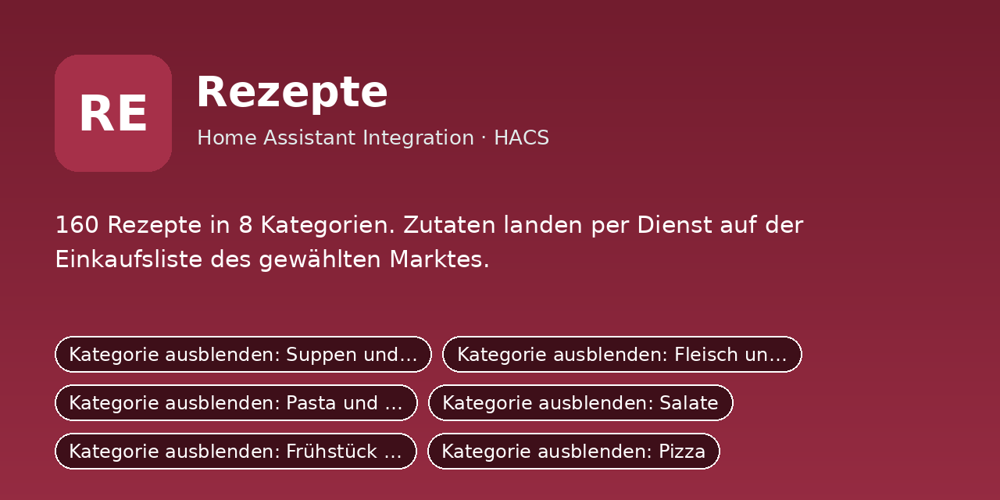

# Rezepte

160 Rezepte in 8 Kategorien. Zutaten landen per Dienst auf der Einkaufsliste des gewählten Marktes.

Python-Integration für Home Assistant (HACS). Sie ersetzt das bisherige YAML-Paket
`rezepte/packages/rezepte.yaml`: Einstellungen sind jetzt eigene Entitäten (Schalter, Zahlen, Auswahlfelder,
Uhrzeiten), die Logik läuft in Python statt in Automationen und Skripten.

## Installation

1. HACS → Integrationen → ⋮ → **Benutzerdefinierte Repositories** →
   `https://github.com/DerGnom1977/ha-rezepte-integration` als Kategorie **Integration** hinzufügen.
2. **Rezepte** installieren und Home Assistant neu starten.
3. Einstellungen → Geräte & Dienste → **Integration hinzufügen** → *Rezepte*.
4. Das Dashboard aus `dashboards/rezepte_dashboard.yaml` anlegen (Raw-Konfigurationseditor).

Manuell: Ordner `custom_components/rezepte` nach `/config/custom_components/` kopieren.

## Einrichtung

Beim Hinzufügen (und später über „Konfigurieren“) werden diese Angaben abgefragt:

- **To-do-Liste für eigene Rezepte** (`eigene_liste`), Standard: `todo.eigene_rezepte`

## Was du anpassen musst

Alle Standardwerte oben sind **Platzhalter/Beispiele**. Passe sie beim Einrichten an dein System an:

- **Notify-Dienste** (`notify_person1`, `notify_person2`): Name deines Handy-Dienstes ohne `notify.`,
  z. B. `mobile_app_mein_handy` → bei dir `mobile_app_<gerätename>` (Entwicklerwerkzeuge → Aktionen → „notify“).
  „Person 1/Person 2“ sind frei; die Schalter *Push an Person 1/2* schalten die jeweilige Meldung.
- **Entitäten** (`sensor.…`, `camera.…`, `person.…`, `todo.…` usw.): auf die echten Entitäts-IDs aus
  Einstellungen → Geräte & Dienste → Entitäten ändern. Leere Felder sind Pflicht, wenn die Funktion genutzt wird.
- **Dashboard** (`dashboards/rezepte_dashboard.yaml`): enthält Entitäts-IDs der Integration; wenn du Namen
  oder Räume änderst, dort per Suchen/Ersetzen nachziehen.
- Später jederzeit unter Einstellungen → Geräte & Dienste → *Rezepte* → **Konfigurieren** änderbar.

## Umstieg vom YAML-Paket

1. Das alte Paket `rezepte/packages/rezepte.yaml` (und sein Dashboard) aus `/config/packages/` entfernen
   und Home Assistant neu starten, damit Helfer, Automationen und Skripte nicht doppelt laufen.
2. Integration einrichten. Neue Entitäten haben dieselben Namen wie die alten Helfer, nur mit
   anderer Domain, z. B. `input_boolean.xyz` wird `switch.xyz`, `input_number.xyz` wird `number.xyz`,
   `input_select.xyz` wird `select.xyz`, `input_datetime.xyz` wird `time.xyz`.
3. Eigene Automationen und Dashboards, die alte Entitäten nutzen, entsprechend anpassen.
4. Die alten Standardwerte sind schon eingebaut, die Einstellungen bleiben nach Neustarts erhalten.

## Dienste

- `rezepte.rezept_einkaufen` – Legt die Zutaten eines Rezepts auf die Einkaufsliste des gewählten Marktes.
- `rezepte.eigenes_rezept_anlegen` – Speichert ein eigenes Rezept in der To-do-Liste.
- `rezepte.alle_einblenden` – Blendet alle ausgeblendeten Rezepte und Kategorien wieder ein.

## Entitäten

### Schalter

- `switch.kategorie_ausblenden_rezepte` – Kategorie ausblenden: Suppen und Eintöpfe
- `switch.kategorie_ausblenden_hauptgerichte` – Kategorie ausblenden: Fleisch und Hauptgerichte
- `switch.kategorie_ausblenden_pasta` – Kategorie ausblenden: Pasta und Aufläufe
- `switch.kategorie_ausblenden_salate` – Kategorie ausblenden: Salate
- `switch.kategorie_ausblenden_fruehstueck` – Kategorie ausblenden: Frühstück und Süßes
- `switch.kategorie_ausblenden_pizza` – Kategorie ausblenden: Pizza
- `switch.kategorie_ausblenden_backen` – Kategorie ausblenden: Backen
- `switch.kategorie_ausblenden_weihnachtsplaetzchen` – Kategorie ausblenden: Weihnachtsplätzchen
- `switch.rezept_ausblenden_kaese_lauch_suppe` – Rezept ausblenden: Käse-Lauch-Suppe
- `switch.rezept_ausblenden_huehnersuppe` – Rezept ausblenden: Hühnersuppe
- `switch.rezept_ausblenden_linsensuppe` – Rezept ausblenden: Linsensuppe
- `switch.rezept_ausblenden_erbsensuppe` – Rezept ausblenden: Erbsensuppe
- `switch.rezept_ausblenden_kuerbissuppe` – Rezept ausblenden: Kürbissuppe
- `switch.rezept_ausblenden_kartoffelsuppe` – Rezept ausblenden: Kartoffelsuppe
- `switch.rezept_ausblenden_tomatensuppe` – Rezept ausblenden: Tomatensuppe
- `switch.rezept_ausblenden_gulaschsuppe` – Rezept ausblenden: Gulaschsuppe
- `switch.rezept_ausblenden_zwiebelsuppe` – Rezept ausblenden: Zwiebelsuppe überbacken
- `switch.rezept_ausblenden_gemuesetopf` – Rezept ausblenden: Gemüseeintopf
- `switch.rezept_ausblenden_frikadellen` – Rezept ausblenden: Frikadellen
- `switch.rezept_ausblenden_rindergulasch` – Rezept ausblenden: Rindergulasch
- `switch.rezept_ausblenden_haehnchen_curry` – Rezept ausblenden: Hähnchen-Curry mit Reis
- `switch.rezept_ausblenden_gemuesepfanne` – Rezept ausblenden: Gemüsepfanne mit Reis
- `switch.rezept_ausblenden_schnitzel` – Rezept ausblenden: Schnitzel (Wiener Art)
- `switch.rezept_ausblenden_rouladen` – Rezept ausblenden: Rinderrouladen
- `switch.rezept_ausblenden_hackbraten` – Rezept ausblenden: Hackbraten
- `switch.rezept_ausblenden_bratkartoffeln` – Rezept ausblenden: Bratkartoffeln mit Spiegelei
- `switch.rezept_ausblenden_bratwurst_puree` – Rezept ausblenden: Bratwurst mit Kartoffelpüree
- `switch.rezept_ausblenden_chili` – Rezept ausblenden: Chili con Carne
- `switch.rezept_ausblenden_spaghetti_bolognese` – Rezept ausblenden: Spaghetti Bolognese
- `switch.rezept_ausblenden_blumenkohl_mac_and_cheese` – Rezept ausblenden: Knuspriger Blumenkohl Mac and Cheese
- `switch.rezept_ausblenden_lasagne` – Rezept ausblenden: Lasagne
- `switch.rezept_ausblenden_spaghetti_carbonara` – Rezept ausblenden: Spaghetti Carbonara
- `switch.rezept_ausblenden_aglio_olio` – Rezept ausblenden: Spaghetti Aglio e Olio
- `switch.rezept_ausblenden_arrabbiata` – Rezept ausblenden: Penne all'arrabbiata
- `switch.rezept_ausblenden_hack_sahne_nudeln` – Rezept ausblenden: Hack-Sahne-Nudeln
- `switch.rezept_ausblenden_kartoffelgratin` – Rezept ausblenden: Kartoffelgratin
- `switch.rezept_ausblenden_schinken_nudelauflauf` – Rezept ausblenden: Schinken-Nudel-Auflauf
- `switch.rezept_ausblenden_kaesespaetzle` – Rezept ausblenden: Käsespätzle
- `switch.rezept_ausblenden_kartoffelsalat` – Rezept ausblenden: Kartoffelsalat mit Brühe
- `switch.rezept_ausblenden_nudelsalat` – Rezept ausblenden: Nudelsalat
- `switch.rezept_ausblenden_griechischer_salat` – Rezept ausblenden: Griechischer Salat
- `switch.rezept_ausblenden_caesar_salad` – Rezept ausblenden: Caesar Salad
- `switch.rezept_ausblenden_tomate_mozzarella` – Rezept ausblenden: Tomate-Mozzarella
- `switch.rezept_ausblenden_gurkensalat` – Rezept ausblenden: Gurkensalat mit Dill-Joghurt
- `switch.rezept_ausblenden_krautsalat` – Rezept ausblenden: Krautsalat (Coleslaw)
- `switch.rezept_ausblenden_bohnensalat` – Rezept ausblenden: Bunter Bohnensalat
- `switch.rezept_ausblenden_wurstsalat` – Rezept ausblenden: Wurstsalat
- `switch.rezept_ausblenden_haehnchensalat` – Rezept ausblenden: Salat mit Hähnchenstreifen
- `switch.rezept_ausblenden_pfannkuchen` – Rezept ausblenden: Pfannkuchen
- `switch.rezept_ausblenden_milchreis` – Rezept ausblenden: Milchreis
- `switch.rezept_ausblenden_kaiserschmarrn` – Rezept ausblenden: Kaiserschmarrn
- `switch.rezept_ausblenden_ruehrei` – Rezept ausblenden: Rührei mit Brot
- `switch.rezept_ausblenden_overnight_oats` – Rezept ausblenden: Overnight Oats
- `switch.rezept_ausblenden_arme_ritter` – Rezept ausblenden: Arme Ritter (French Toast)
- `switch.rezept_ausblenden_waffeln` – Rezept ausblenden: Waffeln
- `switch.rezept_ausblenden_porridge` – Rezept ausblenden: Porridge mit Banane
- `switch.rezept_ausblenden_pancakes` – Rezept ausblenden: Pancakes
- `switch.rezept_ausblenden_griessbrei` – Rezept ausblenden: Grießbrei
- `switch.rezept_ausblenden_pizza_margherita` – Rezept ausblenden: Pizza Margherita
- `switch.rezept_ausblenden_pizza_salami` – Rezept ausblenden: Pizza Salami
- `switch.rezept_ausblenden_pizza_schinken_pilze` – Rezept ausblenden: Pizza Schinken-Champignon
- `switch.rezept_ausblenden_pizza_hawaii` – Rezept ausblenden: Pizza Hawaii
- `switch.rezept_ausblenden_pizza_thunfisch` – Rezept ausblenden: Pizza Thunfisch-Zwiebel
- `switch.rezept_ausblenden_pizza_garnelen_hollandaise` – Rezept ausblenden: Pizza mit Garnelen und Hollandaise
- `switch.rezept_ausblenden_pizza_brokkoli_huhn_hollandaise` – Rezept ausblenden: Pizza mit Brokkoli, Hähnchen und Hollandaise
- `switch.rezept_ausblenden_pizza_vier_kaese` – Rezept ausblenden: Pizza Quattro Formaggi
- `switch.rezept_ausblenden_pizza_diavola` – Rezept ausblenden: Pizza Diavola
- `switch.rezept_ausblenden_pizza_calzone` – Rezept ausblenden: Calzone
- `switch.rezept_ausblenden_marmorkuchen` – Rezept ausblenden: Marmorkuchen
- `switch.rezept_ausblenden_apfelkuchen` – Rezept ausblenden: Versunkener Apfelkuchen
- `switch.rezept_ausblenden_kaesekuchen` – Rezept ausblenden: Käsekuchen
- `switch.rezept_ausblenden_zitronenkuchen` – Rezept ausblenden: Zitronenkuchen
- `switch.rezept_ausblenden_brownies` – Rezept ausblenden: Brownies
- `switch.rezept_ausblenden_bananenbrot` – Rezept ausblenden: Bananenbrot
- `switch.rezept_ausblenden_schoko_muffins` – Rezept ausblenden: Schoko-Muffins
- `switch.rezept_ausblenden_streuselkuchen` – Rezept ausblenden: Streuselkuchen vom Blech
- `switch.rezept_ausblenden_quarkbroetchen` – Rezept ausblenden: Quarkbrötchen
- `switch.rezept_ausblenden_hefezopf` – Rezept ausblenden: Hefezopf
- `switch.rezept_ausblenden_vanillekipferl` – Rezept ausblenden: Vanillekipferl
- `switch.rezept_ausblenden_butterplaetzchen` – Rezept ausblenden: Butterplätzchen zum Ausstechen
- `switch.rezept_ausblenden_zimtsterne` – Rezept ausblenden: Zimtsterne
- `switch.rezept_ausblenden_spitzbuben` – Rezept ausblenden: Spitzbuben (Linzer Plätzchen)
- `switch.rezept_ausblenden_lebkuchen` – Rezept ausblenden: Lebkuchen vom Blech
- `switch.rezept_ausblenden_kokosmakronen` – Rezept ausblenden: Kokosmakronen
- `switch.rezept_ausblenden_spritzgebaeck` – Rezept ausblenden: Spritzgebäck
- `switch.rezept_ausblenden_schwarz_weiss` – Rezept ausblenden: Schwarz-Weiß-Gebäck
- `switch.rezept_ausblenden_nussecken` – Rezept ausblenden: Nussecken
- `switch.rezept_ausblenden_haferflocken_cookies` – Rezept ausblenden: Haferflocken-Schoko-Cookies
- `switch.rezept_ausblenden_minestrone` – Rezept ausblenden: Minestrone
- `switch.rezept_ausblenden_soljanka` – Rezept ausblenden: Soljanka
- `switch.rezept_ausblenden_bohnensuppe_serbisch` – Rezept ausblenden: Serbische Bohnensuppe
- `switch.rezept_ausblenden_brokkoli_kaese_suppe` – Rezept ausblenden: Brokkoli-Käse-Suppe
- `switch.rezept_ausblenden_champignon_cremesuppe` – Rezept ausblenden: Champignon-Cremesuppe
- `switch.rezept_ausblenden_moehren_ingwer_suppe` – Rezept ausblenden: Möhren-Ingwer-Suppe
- `switch.rezept_ausblenden_suesskartoffel_kokos_suppe` – Rezept ausblenden: Süßkartoffel-Kokos-Suppe
- `switch.rezept_ausblenden_pichelsteiner` – Rezept ausblenden: Pichelsteiner Eintopf
- `switch.rezept_ausblenden_rote_linsen_suppe` – Rezept ausblenden: Rote Linsensuppe mit Kokos
- `switch.rezept_ausblenden_griessnockerlsuppe` – Rezept ausblenden: Grießnockerlsuppe
- `switch.rezept_ausblenden_koenigsberger_klopse` – Rezept ausblenden: Königsberger Klopse
- `switch.rezept_ausblenden_zuercher_geschnetzeltes` – Rezept ausblenden: Züricher Geschnetzeltes
- `switch.rezept_ausblenden_jaegerschnitzel` – Rezept ausblenden: Jägerschnitzel mit Champignonrahm
- `switch.rezept_ausblenden_schweinebraten` – Rezept ausblenden: Schweinebraten mit Kruste
- `switch.rezept_ausblenden_ofenhaehnchen` – Rezept ausblenden: Ofenhähnchen mit Kartoffeln
- `switch.rezept_ausblenden_gyros_pfanne` – Rezept ausblenden: Gyros-Pfanne mit Tzatziki
- `switch.rezept_ausblenden_currywurst` – Rezept ausblenden: Currywurst mit Pommes
- `switch.rezept_ausblenden_burger` – Rezept ausblenden: Hamburger selbstgemacht
- `switch.rezept_ausblenden_lachs_dill` – Rezept ausblenden: Lachs mit Zitronen-Dill-Sauce
- `switch.rezept_ausblenden_kasseler_sauerkraut` – Rezept ausblenden: Kasseler mit Sauerkraut und Püree
- `switch.rezept_ausblenden_lachs_sahne_nudeln` – Rezept ausblenden: Lachs-Sahne-Nudeln
- `switch.rezept_ausblenden_gnocchi_auflauf` – Rezept ausblenden: Gnocchi-Auflauf mit Tomate und Mozzarella
- `switch.rezept_ausblenden_cannelloni_spinat` – Rezept ausblenden: Cannelloni mit Spinat und Ricotta
- `switch.rezept_ausblenden_pasta_pesto` – Rezept ausblenden: Pasta al Pesto Genovese
- `switch.rezept_ausblenden_penne_vodka` – Rezept ausblenden: Penne alla Vodka
- `switch.rezept_ausblenden_spaghetti_napoli` – Rezept ausblenden: Spaghetti Napoli
- `switch.rezept_ausblenden_tortellini_sahne` – Rezept ausblenden: Tortellini in Schinken-Sahne-Sauce
- `switch.rezept_ausblenden_pasta_haehnchen_brokkoli` – Rezept ausblenden: Pasta mit Hähnchen und Brokkoli
- `switch.rezept_ausblenden_ofen_feta_nudeln` – Rezept ausblenden: Ofen-Feta-Nudeln
- `switch.rezept_ausblenden_puttanesca` – Rezept ausblenden: Spaghetti Puttanesca
- `switch.rezept_ausblenden_couscous_salat` – Rezept ausblenden: Couscous-Salat mit Minze
- `switch.rezept_ausblenden_linsensalat` – Rezept ausblenden: Linsensalat mit Feta
- `switch.rezept_ausblenden_thunfischsalat` – Rezept ausblenden: Thunfisch-Salat mit Ei
- `switch.rezept_ausblenden_eiersalat` – Rezept ausblenden: Eiersalat
- `switch.rezept_ausblenden_waldorfsalat` – Rezept ausblenden: Waldorfsalat
- `switch.rezept_ausblenden_feldsalat_speck` – Rezept ausblenden: Feldsalat mit Speck und Ei
- `switch.rezept_ausblenden_rote_bete_feta_salat` – Rezept ausblenden: Rote-Bete-Salat mit Feta und Walnüssen
- `switch.rezept_ausblenden_tortellinisalat` – Rezept ausblenden: Tortellinisalat mit Pesto
- `switch.rezept_ausblenden_kichererbsen_salat` – Rezept ausblenden: Kichererbsen-Salat
- `switch.rezept_ausblenden_karotten_orangen_salat` – Rezept ausblenden: Karotten-Orangen-Salat
- `switch.rezept_ausblenden_shakshuka` – Rezept ausblenden: Shakshuka
- `switch.rezept_ausblenden_avocado_ei_toast` – Rezept ausblenden: Avocado-Ei-Toast
- `switch.rezept_ausblenden_bircher_muesli` – Rezept ausblenden: Bircher-Müsli
- `switch.rezept_ausblenden_omelett` – Rezept ausblenden: Omelett mit Schinken und Käse
- `switch.rezept_ausblenden_kartoffelpuffer` – Rezept ausblenden: Kartoffelpuffer mit Apfelmus
- `switch.rezept_ausblenden_crepes` – Rezept ausblenden: Crêpes mit Banane und Nuss-Nougat-Creme
- `switch.rezept_ausblenden_quarkkeulchen` – Rezept ausblenden: Quarkkeulchen
- `switch.rezept_ausblenden_smoothie_bowl` – Rezept ausblenden: Smoothie Bowl mit Beeren
- `switch.rezept_ausblenden_apfelpfannkuchen` – Rezept ausblenden: Apfelpfannkuchen
- `switch.rezept_ausblenden_bauernfruehstueck` – Rezept ausblenden: Bauernfrühstück
- `switch.rezept_ausblenden_pizza_prosciutto_rucola` – Rezept ausblenden: Pizza Prosciutto e Rucola
- `switch.rezept_ausblenden_pizza_bbq_haehnchen` – Rezept ausblenden: Pizza BBQ-Hähnchen
- `switch.rezept_ausblenden_pizza_flammkuchen` – Rezept ausblenden: Flammkuchen (Elsässer Art)
- `switch.rezept_ausblenden_pizza_gorgonzola_birne` – Rezept ausblenden: Pizza Gorgonzola-Birne-Walnuss
- `switch.rezept_ausblenden_pizza_salsiccia_paprika` – Rezept ausblenden: Pizza Salsiccia e Peperoni
- `switch.rezept_ausblenden_pizza_spinat_feta` – Rezept ausblenden: Pizza mit Spinat und Feta
- `switch.rezept_ausblenden_pizza_frutti_di_mare` – Rezept ausblenden: Pizza Frutti di Mare
- `switch.rezept_ausblenden_pizza_hack_zwiebel` – Rezept ausblenden: Pizza mit Hack und Zwiebeln
- `switch.rezept_ausblenden_pizza_pesto_tomate` – Rezept ausblenden: Pizza Pesto-Tomate-Mozzarella
- `switch.rezept_ausblenden_pizza_kartoffel_rosmarin` – Rezept ausblenden: Pizza Kartoffel-Rosmarin
- `switch.rezept_ausblenden_donauwelle` – Rezept ausblenden: Donauwelle
- `switch.rezept_ausblenden_zupfkuchen` – Rezept ausblenden: Russischer Zupfkuchen
- `switch.rezept_ausblenden_biskuitrolle` – Rezept ausblenden: Biskuitrolle mit Marmelade
- `switch.rezept_ausblenden_bienenstich` – Rezept ausblenden: Bienenstich
- `switch.rezept_ausblenden_eierlikoerkuchen` – Rezept ausblenden: Eierlikörkuchen
- `switch.rezept_ausblenden_blaubeer_muffins` – Rezept ausblenden: Blaubeer-Muffins
- `switch.rezept_ausblenden_saftiger_schokokuchen` – Rezept ausblenden: Saftiger Schokoladenkuchen
- `switch.rezept_ausblenden_obstkuchen_blech` – Rezept ausblenden: Rührteig-Obstkuchen vom Blech
- `switch.rezept_ausblenden_zimtschnecken` – Rezept ausblenden: Zimtschnecken
- `switch.rezept_ausblenden_joghurtbrot` – Rezept ausblenden: Joghurtbrot
- `switch.rezept_ausblenden_spekulatius` – Rezept ausblenden: Spekulatius
- `switch.rezept_ausblenden_engelsaugen` – Rezept ausblenden: Engelsaugen
- `switch.rezept_ausblenden_pfeffernuesse` – Rezept ausblenden: Pfeffernüsse
- `switch.rezept_ausblenden_haselnussmakronen` – Rezept ausblenden: Haselnussmakronen
- `switch.rezept_ausblenden_anisplaetzchen` – Rezept ausblenden: Anisplätzchen
- `switch.rezept_ausblenden_heidesand` – Rezept ausblenden: Heidesand
- `switch.rezept_ausblenden_florentiner` – Rezept ausblenden: Florentiner
- `switch.rezept_ausblenden_mandelhoernchen` – Rezept ausblenden: Mandelhörnchen
- `switch.rezept_ausblenden_schoko_orangen_plaetzchen` – Rezept ausblenden: Schoko-Orangen-Plätzchen
- `switch.rezept_ausblenden_zimtplaetzchen` – Rezept ausblenden: Zimtplätzchen

### Auswahlfelder

- `select.rezepte_einkauf_markt` – Einkaufen bei

### Knöpfe

- `button.rezepte_alle_einblenden` – Alles einblenden

## Hinweis

Die Integration wurde aus dem bestehenden YAML-Paket portiert und ist noch nicht in einer laufenden
Home-Assistant-Instanz getestet. Bitte beim ersten Einsatz die Logbuch-/Protokoll-Meldungen
(`custom_components.rezepte`) im Blick behalten.
